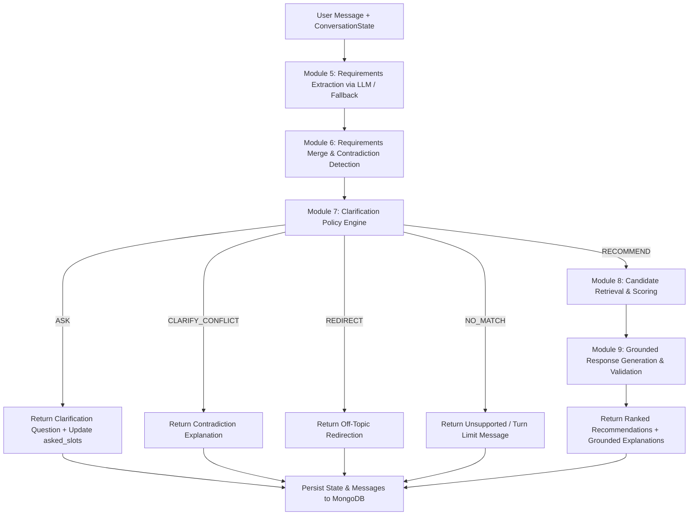

# Electronics Recommendation Agent

An intelligent, multi-category electronics recommendation engine powered by **Local MongoDB**, **FastAPI**, and **Groq Cloud API**.

> **Architecture Principle:**  
> *"The LLM understands and words; deterministic Python code decides and enforces."*

---

## 1. Project Overview

The **Electronics Recommendation Agent** assists consumers in finding the right electronics across five primary categories:
- **Laptops**
- **Smartphones**
- **Headphones**
- **Tablets**
- **Monitors**

Rather than allowing an LLM to hallucinate specifications or prices, the agent utilizes a hybrid architecture:
1. **Natural Language Understanding (NLU):** Groq Cloud API parses conversational user requests into structured constraint filters (e.g., budget limits, performance targets, form factors).
2. **Deterministic Matching & Scoring:** Pure Python domain logic queries a local MongoDB catalogue, applies hard constraints, ranks candidate products, and deterministically selects the top two matching products.
3. **Conversational Synthesis:** Groq formats the final recommendation into natural, helpful conversational responses justifying the choice.

---

## 2. Technology Stack

- **Backend Framework:** FastAPI 0.110+ (Python 3.12)
- **ASGI Server:** Uvicorn with standard extras
- **Data Validation & Settings:** Pydantic v2 & Pydantic-Settings
- **Database Driver:** Motor (asyncio driver for MongoDB)
- **Database Engine:** Local MongoDB instance (`mongodb://localhost:27017`)
- **LLM Provider:** Groq Cloud API (`https://api.groq.com/openai/v1`)
- **Testing & Verification:** Pytest, Pytest-Asyncio, HTTPX
- **Frontend (Future):** React + Vite (planned for later module)

---

## 3. Project Modules & Scope

### Module 1: Project Scaffold and Configuration
- Standardized directory layout for backend, frontend placeholder, and documentation.
- Typed settings configuration loaded from `.env` and system environment variables.
- Asynchronous connection manager for local MongoDB with admin ping verification.
- Centralized logging with credential masking and duplicate handler prevention.
- Reusable `AppError` and custom exception handlers with `X-Request-ID` tracking.
- Automated scaffold tests verifying lifecycle, config, and offline operation.

### Module 2: Data Layer and Product Catalogue
- Validated Pydantic v2 `Product` model supporting 5 categories with category-specific specification validation.
- MongoDB persistence via `ProductRepository` providing `get()`, `find()`, `count()`, and `categories()`.
- Synthetic product catalogue (`backend/data/products.json`) containing exactly 120 products with diverse specs and edge cases.
- Idempotent bulk upsert seed script (`backend/scripts/seed.py`) with automatic index creation.

### Module 3: Product and Health API
- Read-only public REST API routes mounted under `/api/v1`.
- `GET /api/v1/products`: Filterable, paginated product search with deterministic sorting.
- `GET /api/v1/products/{product_id}`: Single product retrieval with 404 error envelope handling.
- `GET /api/v1/products/categories`: Category summary aggregation endpoint with counts and price bounds.
- `GET /api/v1/health`: Dependency health check reporting MongoDB and Groq status independently without text generation.
- 81 automated tests verifying models, repository operations, API responses, and health diagnostics.

### Module 4: Groq LLM Client & Structured Output Infrastructure
- Reusable, asynchronous Groq Cloud API client implementing the `LLMClient` protocol.
- Unstructured text generation (`complete_text`) with token limits and temperature controls.
- Structured JSON output (`complete_json`) validated directly against Pydantic v2 schemas.
- Resilient retry policy with bounded exponential backoff and `Retry-After` header parsing.
- Sanitized exception hierarchy protecting secrets and API credentials.
- Deterministic `FakeLLMClient` for offline testing and downstream module development.
- 27 new tests (108 total suite) verifying completions, errors, retries, and offline isolation.

### Module 5: Requirements Model & Natural-Language Extractor
- Strict typed Pydantic v2 requirements domain models: `HardConstraints`, `Requirements`, `RequirementsDelta`, `Message`.
- Natural-language requirement extraction via `extract()` using injected `LLMClient.complete_json()` and prompt builder.
- Strict context isolation: limits conversation history to at most the last 6 messages.
- Pure Python deterministic normalizer (`normalize()`): parses Indian currency expressions (`80k`, `1.2 lakh`, `70 hazaar`), category aliases (`lappy` -> laptop), use-case synonyms (`coding` -> programming), and bounded preference weights (0.0 to 1.0).
- Explicit removal tracking via `removed_fields` ensuring missing fields are never mistaken for deletion.
- 15 canonical handwritten extraction scenarios in `app.agent.examples.EXTRACTION_EXAMPLES`.
- 100 new automated offline tests (208 total suite) with 0ms mock execution and 0 external network requests during pytest.

### Module 6: Multi-Turn Requirements Merging & Contradiction Resolution
- Pure Python multi-turn requirements merger: `merge(current, delta) -> tuple[Requirements, list[Contradiction]]`.
- Predictable field preservation: unmentioned attributes remain unchanged.
- Explicit update semantics: replacements overwrite previous values without false contradiction alerts.
- Set-like deduplicated list merging for `use_cases` and `exclude_brands`.
- Fine-grained preference management: updates weights and removes individual keys via `removed_fields`.
- Deterministic contradiction detection: `BUDGET_MIN_EXCEEDS_MAX`, `GPU_FALSE_WITH_MIN_VRAM`, `ML_LOCAL_CONFLICTS_NO_GPU`, and `CATEGORY_SPEC_INCOMPATIBLE`.
- Zero LLM calls or network requests: completely offline, pure Python domain state logic.
- 19 new tests covering immutability, removals, contradictions, and regressions.

### Module 7: Clarification Policy & Slot-Filling Decision Engine
- Deterministic decision-making engine: `decide_next_action(requirements, contradictions, asked_slots, turn_count, max_turns) -> PolicyDecision`.
- Strict action outcomes: `ASK`, `CLARIFY_CONFLICT`, `REDIRECT`, `NO_MATCH`, and `RECOMMEND`.
- Clear, prioritized question selection: off-topic -> unsupported categories -> turn limit check -> missing category -> unresolved contradictions -> missing budget -> missing use cases -> critical technical constraints -> recommendations.
- Category-tailored use case inquiry across all 5 supported categories (laptop, phone, headphones, tablet, monitor).
- Slot-filling memory and tracking: normalizes slot aliases and avoids repeatedly asking questions already answered.
- Clarification turn limit enforcement (`MAX_CLARIFICATION_TURNS = 3`): safely terminates endless questioning and falls back or proceeds to recommendations gracefully.
- Clear separation of concerns: policy handles conversational flow and information sufficiency; product search and candidate ranking are strictly deferred to Module 8.
- 29 new automated offline tests covering policy rules, turn limits, and immutability.

### Module 8: Product Candidate Retrieval & Scoring Engine
- Deterministic candidate retrieval via `retrieve_candidates(requirements, repository)` restricting queries to requested categories.
- Hard-constraint evaluation with strict 3-way semantics: `PASS`, `FAIL`, and `UNKNOWN`. Missing catalogue specs are treated as unverifiable and excluded from recommendations.
- Evaluates maximum/minimum budget, RAM, storage, battery runtime, maximum weight, dedicated GPU, minimum VRAM, brand exclusions, and in-stock availability.
- Transparent multi-factor preference scoring (0-100 scale) covering portability, performance, battery life, display quality, camera, GPU power, noise cancellation, and build quality.
- Safe weight normalization: user preference weights are normalized proportionally, while unspecified preferences do not penalize products.
- Fully deterministic ranking with composite score descending, price ascending, and product ID ascending tie-breaking.
- End-to-end coordinator `search_and_rank()` emitting structured `CandidateSearchResult` with full visibility into passed, excluded, and unverifiable candidates.
- 32 new automated offline tests (288 total suite) with zero LLM calls or network requests.

### Module 9: Response Generation & Grounded Validation Engine
- Structured Pydantic response models (`ProductRecommendation`, `RecommendationResponse`, `LLMRecommendationPayload`, `LLMProductExplanation`) strictly decoupling authoritative catalogue truth from generated explanatory text.
- Generates tailored, natural-language recommendation explanations using Groq (`generate_recommendation_response()`) grounded strictly in Module 8 ranked candidates.
- Pure Python deterministic validation (`validate_recommendation_response()`):
  - Enforces authoritative product identity: rejects hallucinated IDs, unranked products, and hard-constraint failures.
  - Enforces Module 8 ranking order invariance: LLM cannot reorder candidates or modify rank scores.
  - Copies authoritative prices, specs, and metadata directly from catalogue records.
  - Grounds numerical claims via regex contradiction checking (prices, RAM, storage, discrete GPUs, battery runtime, monitor weight).
  - Automatically repairs ungrounded claims with safe, deterministic fallbacks in $O(1)$ time without infinite LLM loops.
- Deterministic offline fallbacks (`build_fallback_recommendation_response()`) for API timeouts, schema validation errors, malformed JSON, and zero-match searches.
- 23 new automated offline tests (311 total suite) verifying generation, validation, repairs, and offline isolation.

### Module 10: Agent Orchestration Pipeline & Conversation API
- End-to-end multi-turn pipeline (`run_pipeline()`) coordinating requirements extraction (Module 5), state merging & contradiction resolution (Module 6), clarification policy (Module 7), candidate retrieval & scoring (Module 8), and grounded recommendation response generation (Module 9).
- Persistent conversation state management in MongoDB collection `conversations` via `ConversationRepository`:
  - Enforces atomic state persistence and optimistic concurrency control with version locking (`version`).
  - Strict ownership access control (`X-User-ID` header validation) rejecting unauthorized access with 403 Forbidden.
  - Complete chronological message history storage without leaking internal scratchpads or hidden chains of thought.
  - In-memory conversation repository (`InMemoryConversationRepository`) for 100% offline test isolation.
- RESTful Conversation API endpoints under `/api/v1/conversations`:
  - `POST /api/v1/conversations`: Initialize conversation session.
  - `POST /api/v1/conversations/{id}/messages`: Submit message, advance turn, and execute full agent pipeline.
  - `GET /api/v1/conversations/{id}`: Inspect current accumulated requirements and turn metadata.
  - `GET /api/v1/conversations/{id}/messages`: Retrieve chronological message history.
  - `DELETE /api/v1/conversations/{id}`: Delete conversation session and associated history.
- 24 new automated offline tests (335 total suite) covering the complete conversation lifecycle, revisions, turn limits, error envelopes, and concurrency.

---

## 4. Repository Structure

```text
snippet-intern/
├── backend/
│   ├── app/
│   │   ├── __init__.py          # Application package root
│   │   ├── main.py              # FastAPI app factory, lifespan, and router mounting
│   │   ├── api/
│   │   │   ├── __init__.py      # Export health_router, products_router, conversations_router
│   │   │   ├── products.py      # Product listing, filtering, detail, & categories
│   │   │   ├── health.py        # Independent MongoDB & Groq health check
│   │   │   └── v1/
│   │   │       ├── __init__.py
│   │   │       └── conversations.py # Module 10 conversational chat API endpoints
│   │   ├── core/
│   │   │   ├── __init__.py
│   │   │   ├── config.py        # Pydantic Settings & environment validation
│   │   │   ├── logging.py       # Structured logging & secret scrubbing filter
│   │   │   └── errors.py        # AppError hierarchy, request IDs & custom handlers
│   │   ├── models/
│   │   │   ├── __init__.py      # Export domain, ranking, response, and conversation models
│   │   │   ├── product.py       # Pydantic Product model & category spec schemas
│   │   │   ├── ranking.py       # CandidateEvaluation, ScoreBreakdown, RankedCandidate, CandidateSearchResult
│   │   │   ├── requirements.py  # Requirements, RequirementsDelta, HardConstraints, Contradiction, PolicyDecision
│   │   │   ├── response.py      # ProductRecommendation, RecommendationResponse, LLMRecommendationPayload (Module 9)
│   │   │   ├── conversation.py  # ConversationState, ConversationMessage, Turn Response schemas (Module 10)
│   │   │   └── api.py           # ProductListResponse, HealthResponse, ErrorResponse
│   │   ├── db/
│   │   │   ├── __init__.py
│   │   │   ├── mongo.py         # Async Motor connection manager & ping check
│   │   │   ├── repositories.py  # Asynchronous ProductRepository
│   │   │   └── conversation_repository.py # Conversation state repository with version locking (Module 10)
│   │   ├── llm/
│   │   │   ├── __init__.py      # Module 4 exports (LLMClient, GroqClient, FakeLLMClient, errors)
│   │   │   ├── client.py        # GroqClient implementation & retry logic
│   │   │   ├── errors.py        # Sanitized LLM exception hierarchy
│   │   │   ├── fake.py          # Deterministic offline FakeLLMClient
│   │   │   └── prompts.py       # Prompts: extraction (Mod 5) & recommendation explanation (Mod 9)
│   │   └── agent/
│   │       ├── __init__.py      # Agent package exports (Modules 5-10)
│   │       ├── extract.py       # Asynchronous NLU requirements extractor (Module 5)
│   │       ├── normalize.py     # Pure Python deterministic normalization & alias resolver
│   │       ├── merge.py         # Multi-turn state merger & contradiction detector (Module 6)
│   │       ├── policy.py        # Clarification policy & slot-filling engine (Module 7)
│   │       ├── retrieval.py     # Candidate retrieval via ProductRepository (Module 8)
│   │       ├── ranking.py       # Hard filtering, scoring & ranking engine (Module 8)
│   │       ├── respond.py       # Recommendation generation coordinator (Module 9)
│   │       ├── response_validator.py # Deterministic validation, repair & fallback engine (Module 9)
│   │       ├── pipeline.py      # End-to-end multi-module agent coordinator (Module 10)
│   │       └── examples.py      # 15 canonical handwritten extraction scenarios
│   ├── data/
│   │   └── products.json        # 120-item synthetic product catalogue
│   ├── scripts/
│   │   ├── __init__.py
│   │   └── seed.py              # Idempotent MongoDB catalogue seed script
│   ├── tests/
│   │   ├── test_scaffold.py     # Module 1 scaffold and lifecycle tests
│   │   ├── test_product_model.py# Product model validation & spec tests
│   │   ├── test_product_repository.py # Async repository queries & aggregation tests
│   │   ├── test_seed.py         # Catalogue integrity & seed idempotency tests
│   │   ├── test_api_products.py # Product listing, filter, detail & categories tests
│   │   ├── test_api_health.py   # Health check states & credential safety tests
│   │   ├── test_llm_client.py   # Module 4 Groq LLM client, retries, and offline fake tests
│   │   ├── test_requirements_model.py # Module 5 requirements models validation tests
│   │   ├── test_normalize.py    # Module 5 normalization & alias resolution tests
│   │   ├── test_extract.py      # Module 5 NLU extractor offline tests (15 scenarios)
│   │   ├── test_merge.py        # Module 6 state merging & contradiction resolution tests
│   │   ├── test_policy.py       # Module 7 clarification policy & slot-filling tests
│   │   ├── test_retrieval.py    # Module 8 candidate retrieval tests
│   │   ├── test_ranking.py      # Module 8 filtering, scoring, and ranking tests
│   │   ├── test_respond.py      # Module 9 response generation & validation tests
│   │   └── test_conversations.py# Module 10 pipeline and conversation API tests
│   ├── pytest.ini               # Pytest configuration
│   └── requirements.txt         # Bounded backend Python dependencies
├── frontend/
│   └── .gitkeep                 # React frontend placeholder
├── docs/
│   └── .gitkeep                 # Project documentation placeholder
├── .env                         # Local environment file (git-ignored)
├── .env.example                 # Example configuration template
├── .gitignore                   # Git ignore rules
└── README.md                    # Project documentation
```


---

## 5. Prerequisites

1. **Python 3.12+**
   - Verify Python: `python --version` (or `py -3.12 --version` on Windows)
2. **Local MongoDB**
   - MongoDB Community Server must be installed and running locally on port `27017`.
   - The backend connects directly to your existing local MongoDB service; it does not install, start, stop, or manage MongoDB services.
   - **No Docker or Docker Compose is used.**
3. **Groq API Key (for future modules & health check)**
   - Groq API credentials are configured via the root `.env` file.
   - Placeholder keys (such as `replace_me`) allow the backend to boot and run local routes without failing.

---

## 6. Environment Configuration

Copy `.env.example` to create `.env` in the root directory:

```bash
cp .env.example .env
```

### Configuration Variables

| Variable | Description | Default |
|---|---|---|
| `MONGO_URI` | MongoDB connection URI | `mongodb://localhost:27017` |
| `MONGO_DB` | MongoDB database name | `electronics_agent` |
| `LLM_BASE_URL` | Base URL for Groq API | `https://api.groq.com/openai/v1` |
| `LLM_API_KEY` | Private Groq API key | `replace_me` |
| `LLM_MODEL` | Default inference model identifier | `openai/gpt-oss-20b` |
| `LLM_FALLBACK_BASE_URL` | Optional secondary LLM endpoint | *None* |
| `LLM_FALLBACK_MODEL` | Optional secondary model name | *None* |
| `LLM_TIMEOUT_S` | Request timeout in seconds | `30` |
| `LLM_MAX_RETRIES` | Max retries for failed requests | `2` |
| `CORS_ORIGINS` | JSON array of permitted web client origins | `["http://localhost:5173"]` |

---

## 7. Installation and Setup

### Windows (PowerShell)

```powershell
# 1. Navigate to the backend directory
cd backend

# 2. Create Python 3.12 virtual environment
py -3.12 -m venv .venv

# 3. Activate virtual environment
.\.venv\Scripts\Activate.ps1

# 4. Install backend dependencies
python -m pip install --upgrade pip
python -m pip install -r requirements.txt
```

### macOS / Linux (Bash / Zsh)

```bash
# 1. Navigate to the backend directory
cd backend

# 2. Create Python 3.12 virtual environment
python3.12 -m venv .venv

# 3. Activate virtual environment
source .venv/bin/activate

# 4. Install backend dependencies
python -m pip install --upgrade pip
python -m pip install -r requirements.txt
```

---

## 8. Database Seeding (Module 2)

From the `backend` directory with the virtual environment activated:

```powershell
python -m scripts.seed
```

Example Output:
```text
==================================================
ELECTRONICS RECOMMENDATION AGENT — CATALOGUE SEED
==================================================
Products Loaded from JSON: 120
New Records Inserted:     120
Existing Records Updated:  0
Records Unchanged:         0
Total Products in Database:120
==================================================
```

Running the seed script a second time is **100% idempotent** and produces 0 duplicates.

---

## 9. Product & Health API Routes (Module 3)

All application endpoints are mounted under `/api/v1`.

### Endpoints Overview

| Method | Endpoint | Description |
|---|---|---|
| `GET` | `/api/v1/products` | Filterable, paginated search over catalogue products. |
| `GET` | `/api/v1/products/{product_id}` | Retrieve single product by unique ID (e.g. `LAP-0001`). |
| `GET` | `/api/v1/products/categories` | Summary aggregation across all 5 supported categories. |
| `GET` | `/api/v1/health` | Independent status check for local MongoDB and Groq Cloud API. |

---

### Endpoint Details & Query Parameters

#### 1. `GET /api/v1/products`

Retrieve paginated product records matching multiple optional query filters:

| Parameter | Type | Validation / Constraints | Default |
|---|---|---|---|
| `category` | `string` | One of: `laptop`, `phone`, `headphones`, `tablet`, `monitor` | *None* |
| `min_price` | `integer` | Positive integer `>= 0` (inclusive) | *None* |
| `max_price` | `integer` | Positive integer `>= 0` (inclusive). Must be `>= min_price` | *None* |
| `use_case` | `string` | Filter by persona tag in `intended_use` (e.g. `programming`, `gaming`) | *None* |
| `brand` | `string` | Case-insensitive brand name match (e.g. `Zenit`, `Velo`) | *None* |
| `in_stock` | `boolean` | `true` for available, `false` for out of stock | *None* |
| `sort` | `string` | `price_asc`, `price_inr_asc`, `price_desc`, `price_inr_desc`, `rating_desc`, `rating_asc`, `name_asc`, `name_desc` | `price_inr_asc` |
| `page` | `integer` | Minimum: `1` | `1` |
| `page_size` | `integer` | Minimum: `1`, Maximum: `50` | `20` |

**Example Request:**
```http
GET /api/v1/products?category=laptop&min_price=40000&max_price=90000&use_case=programming&page=1&page_size=2
```

**Example Response (HTTP 200):**
```json
{
  "items": [
    {
      "product_id": "LAP-0001",
      "name": "Zenit Air 14",
      "brand": "Zenit",
      "category": "laptop",
      "price_inr": 54999,
      "specs": {
        "cpu": "Intel Core i5-13420H",
        "ram_gb": 16,
        "storage_gb": 512,
        "gpu": "Intel Iris Xe Graphics",
        "vram_gb": 0,
        "weight_kg": 1.35,
        "battery_hr": 10.5,
        "screen_in": 14.0,
        "os": "Windows 11 Home"
      },
      "intended_use": ["programming", "student", "general"],
      "features": ["Backlit Keyboard", "Fingerprint Reader", "FHD IPS Anti-Glare"],
      "in_stock": true,
      "rating": 4.4
    },
    {
      "product_id": "LAP-0026",
      "name": "Nexa CodeBook 14",
      "brand": "Nexa",
      "category": "laptop",
      "price_inr": 49999,
      "specs": {
        "cpu": "AMD Ryzen 5 5600H",
        "ram_gb": 16,
        "storage_gb": 512,
        "gpu": "AMD Radeon Graphics",
        "vram_gb": 0,
        "weight_kg": 1.45,
        "battery_hr": 8.0,
        "screen_in": 14.0,
        "os": "Windows 11 Home"
      },
      "intended_use": ["programming", "student"],
      "features": ["Tactile Keyboard", "Dual Heat Pipes"],
      "in_stock": true,
      "rating": 4.2
    }
  ],
  "total": 13,
  "page": 1,
  "page_size": 2,
  "total_pages": 7
}
```

---

#### 2. `GET /api/v1/products/{product_id}`

Retrieve single product record:

**Example Request:**
```http
GET /api/v1/products/LAP-0001
```

**Example Response (HTTP 200):**
```json
{
  "product_id": "LAP-0001",
  "name": "Zenit Air 14",
  "brand": "Zenit",
  "category": "laptop",
  "price_inr": 54999,
  "specs": {
    "cpu": "Intel Core i5-13420H",
    "ram_gb": 16,
    "storage_gb": 512,
    "gpu": "Intel Iris Xe Graphics",
    "vram_gb": 0,
    "weight_kg": 1.35,
    "battery_hr": 10.5,
    "screen_in": 14.0,
    "os": "Windows 11 Home"
  },
  "intended_use": ["programming", "student", "general"],
  "features": ["Backlit Keyboard", "Fingerprint Reader", "FHD IPS Anti-Glare"],
  "in_stock": true,
  "rating": 4.4
}
```

**Nonexistent Product (HTTP 404):**
```json
{
  "error": {
    "code": "PRODUCT_NOT_FOUND",
    "message": "Product with ID 'NONEXISTENT-999' was not found in the catalogue.",
    "request_id": "5f8a004eb76f44ecb74d4d7eb8090b8f"
  }
}
```

---

#### 3. `GET /api/v1/products/categories`

Retrieve category summary statistics:

**Example Request:**
```http
GET /api/v1/products/categories
```

**Example Response (HTTP 200):**
```json
[
  {
    "category": "laptop",
    "product_count": 40,
    "min_price_inr": 31999,
    "max_price_inr": 249000
  },
  {
    "category": "phone",
    "product_count": 30,
    "min_price_inr": 9999,
    "max_price_inr": 149999
  },
  {
    "category": "headphones",
    "product_count": 20,
    "min_price_inr": 1299,
    "max_price_inr": 34999
  },
  {
    "category": "tablet",
    "product_count": 15,
    "min_price_inr": 9999,
    "max_price_inr": 89999
  },
  {
    "category": "monitor",
    "product_count": 15,
    "min_price_inr": 7999,
    "max_price_inr": 72000
  }
]
```

---

#### 4. `GET /api/v1/health`

Diagnostic check reporting availability of local MongoDB and Groq Cloud API independently:

**Example Response (HTTP 200):**
```json
{
  "status": "degraded",
  "db": "up",
  "llm": "down"
}
```

- `status`: `"ok"` if both `db == "up"` and `llm == "up"`. Otherwise `"degraded"`.
- `db`: `"up"` if local MongoDB responds to an admin ping command; otherwise `"down"`.
- `llm`: `"up"` if Groq Cloud responds with HTTP 200 to an authenticated `/models` request; otherwise `"down"`.
- **Safe Offline Operation:** If `LLM_API_KEY` is empty or set to `"replace_me"`, the endpoint immediately marks `llm: "down"` without making outbound network requests.
- **No Completions Triggered:** The health check only queries provider model availability; it never invokes completion or text generation logic.

---

### Standard Error Handling

Error responses follow a uniform envelope with request correlation tracing:

```json
{
  "error": {
    "code": "PRODUCT_NOT_FOUND",
    "message": "The requested resource was not found.",
    "request_id": "848bb241413a48e7ba453a9e1e2bc00b"
  }
}
```

HTTP Status Codes:
- `200 OK`: Request succeeded.
- `404 Not Found`: Target product ID does not exist.
- `422 Unprocessable Entity`: Input validation error (e.g. `min_price > max_price`, `page_size > 50`, invalid sort or category).
- `500 Internal Server Error`: Unhandled server exception (internal stack traces are never exposed to clients).
- `503 Service Unavailable`: Core database connection failure during startup.

---

## 10. Groq LLM Client & Structured Output Infrastructure (Module 4)

Module 4 provides a reusable, asynchronous LLM infrastructure connecting to the **Groq Cloud API** using an OpenAI-compatible interface. It enforces clean separation between natural-language generation and deterministic data validation.

### Responsibilities
1. **Chat Completion Requests:** Asynchronously dispatches chat messages to Groq Cloud API (`https://api.groq.com/openai/v1`).
2. **Unstructured Text Output:** Returns generated text via `complete_text()` with caller-controlled token bounds.
3. **Structured Pydantic Validation:** Guarantees that structured responses returned by `complete_json()` strictly validate against caller-supplied Pydantic v2 schemas.
4. **Transient Resilience:** Bounded exponential backoff retries for network drops, timeouts, 5xx server errors, and 429 rate limits.
5. **Rate Limit Awareness:** Parses and adheres to HTTP `Retry-After` response headers.
6. **Credential Privacy:** Redacts API keys and Bearer tokens from exceptions, error messages, and logs using regex sanitization.
7. **Offline Testing:** Features a deterministic `FakeLLMClient` for offline test suites and downstream module development without network access.

### Client Interface (`LLMClient` Protocol)

```python
from typing import Protocol, TypeVar
from pydantic import BaseModel

T = TypeVar("T", bound=BaseModel)

class LLMClient(Protocol):
    async def complete_text(
        self,
        messages: list[dict[str, str]],
        max_tokens: int = 400,
        temperature: float = 0.2,
    ) -> str:
        """Send chat messages and return the assistant response as text."""
        ...

    async def complete_json(
        self,
        messages: list[dict[str, str]],
        schema: type[T],
        max_tokens: int = 1000,
        temperature: float = 0.1,
    ) -> T:
        """Send chat messages and return a validated Pydantic v2 model instance."""
        ...

    async def ping(self) -> bool:
        """Perform a lightweight provider connectivity check without generating text."""
        ...

    async def close(self) -> None:
        """Close underlying HTTP client transport resources."""
        ...
```

### Configuration Settings

| Setting | Environment Variable | Default | Description |
|---|---|---|---|
| `llm_base_url` | `LLM_BASE_URL` | `https://api.groq.com/openai/v1` | Groq OpenAI-compatible base URL |
| `llm_api_key` | `LLM_API_KEY` | `replace_me` | Private Groq API key |
| `llm_model` | `LLM_MODEL` | `openai/gpt-oss-20b` | Target inference model ID |
| `llm_timeout_s` | `LLM_TIMEOUT_S` | `30.0` | Request timeout in seconds |
| `llm_max_retries` | `LLM_MAX_RETRIES` | `2` | Maximum retry attempts (bounded 0–5) |

### Structured Output & Pydantic Validation

Structured output generation in `complete_json()` follows a 6-step lifecycle:
1. **Schema Extraction:** Generates standard JSON Schema from `schema.model_json_schema()`.
2. **Prompt Injection:** Appends a strict schema instruction to the conversation system prompt.
3. **JSON Mode Activation:** Requests `response_format={"type": "json_object"}` from Groq.
4. **Code Block Stripping:** Safely extracts payload if wrapped in markdown code blocks (` ```json ... ``` `).
5. **Python Validation:** Parses JSON and executes `schema.model_validate(data)` in Python (never trusts LLM business logic).
6. **Bounded Correction Retries:** If JSON is malformed or validation fails, executes up to 2 correction attempts supplying the LLM with specific error context. If errors persist, raises `LLMSchemaValidationError`.

### Timeout & Retry Policy

- **Retry Definition:** `LLM_MAX_RETRIES` specifies retries *after* the initial attempt (total attempts = `1 + max_retries`, capped between 0 and 5).
- **Exponential Backoff:** Delays calculate as `min(0.5 * (2.0 ** attempt), 10.0)` seconds (0.5s, 1.0s, 2.0s...).
- **Rate-Limit Handling:** When HTTP 429 includes a `Retry-After` header, the client waits for the specified duration (capped at 30s).
- **Retryable Errors:** HTTP 429, 500, 502, 503, 504, `httpx.TimeoutException`, `httpx.NetworkError`.
- **Non-Retryable Errors:** HTTP 401 (`LLMAuthenticationError`), HTTP 403 (`LLMPermissionError`), configuration errors (`LLMConfigurationError`).
- **Injectable Sleeper:** The client accepts `sleep_func` (defaulting to `asyncio.sleep`), allowing tests to inject mock sleepers for instantaneous 0ms test runs.

### Deterministic Offline `FakeLLMClient`

`FakeLLMClient` satisfies the `LLMClient` protocol without opening network sockets:
- Return pre-configured canned text queues (`text_responses`).
- Return pre-configured canned Pydantic models or dictionaries (`json_responses`).
- Simulate malformed JSON decoding failures (`simulate_invalid_json=True`).
- Simulate Pydantic schema validation failures (`simulate_schema_error=True`).
- Simulate provider errors and timeouts (`error_to_raise=LLMTimeoutError(...)`).
- Record call history for assertions (`calls`, `call_count`, `last_messages`).

---

## 11. Requirements Model & Natural-Language Extractor (Module 5)

Module 5 implements the natural-language understanding (NLU) extraction layer that translates conversational user input into structured, validated requirement deltas.

### Core Architecture Principle
> *"The LLM interprets language; pure Python code normalizes and enforces requirements."*

The extractor identifies requirements without making product recommendations, filtering catalogue databases, or making business decisions. Subsequent modules handle requirement state merging (Module 6), contradiction resolution, and ranking.

### Purpose of Requirements & RequirementsDelta
- **`Requirements`:** The accumulated user state across a multi-turn conversation session.
- **`RequirementsDelta`:** The delta extracted from a single user message. Distinguishes newly stated requirements from existing ones, detects explicit removal requests, and classifies off-topic messages.

### Supported Fields and Semantics

| Field | Type | Description | Semantics |
|---|---|---|---|
| `category` | `Category \| None` | Product category (`laptop`, `phone`, `headphones`, `tablet`, `monitor`) | `None` = unchanged; concrete = newly selected or changed |
| `use_cases` | `list[str] \| None` | Normalized personas / uses (`programming`, `gaming`, `student`, `travel`, etc.) | Appended or updated without overwriting unrelated uses |
| `budget_max_inr` | `int \| None` | Maximum budget in Indian Rupees (>= 0) | Overrides previous max budget when explicitly stated |
| `budget_min_inr` | `int \| None` | Minimum budget in Indian Rupees (>= 0) | Lower budget boundary |
| `hard` | `HardConstraints \| None` | Non-negotiable specs (RAM, storage, battery, weight, GPU, brands) | Strict filters enforced deterministically |
| `preferences` | `dict[str, float] \| None` | Soft priorities mapped to numeric weights (`0.0` to `1.0`) | Scored relatively during catalogue ranking |
| `ml_mode` | `str \| None` | Machine learning execution target (`"local"` or `"cloud"`) | Informs GPU requirement |
| `removed_fields` | `list[str]` | Fields or preferences explicitly requested to be cleared | Distinguishes omission from explicit removal |
| `is_off_topic` | `bool` | True if the message is unrelated to electronics shopping | Triggers off-topic policy routing |

### Null Values vs Explicit Removals (`removed_fields`)
- **A `null` or omitted field** indicates that the user's latest message did not mention or change that attribute. It does **not** erase previous requirements.
- **`removed_fields`** explicitly indicates that the user wants to clear or disregard an attribute (e.g. *"remove my budget limit"* -> `removed_fields: ["budget_max_inr"]`; *"I don't care about portability anymore"* -> `removed_fields: ["portability"]`).

### Natural-Language Extraction Flow (`extract()`)

The extraction function in `app.agent.extract` executes a 4-step pipeline:
1. **Input Validation:** Enforces non-empty message text and bounds length to <= 1000 characters.
2. **Context Assembly:** Injects the current accumulated `Requirements` and truncates conversation history to at most the **last 6 messages**.
3. **Structured Inference:** Calls `llm.complete_json(messages, schema=RequirementsDelta)` with the injected `LLMClient`.
4. **Deterministic Normalization:** Applies pure Python `normalize()` to resolve currency expressions, aliases, and preference weights.

### Deterministic Normalization (`normalize()`)

`app.agent.normalize` is a pure Python, idempotent normalizer:
- **Indian Currency (INR) Expressions:**
  - `80k`, `80 K`, `80K` -> `80000`
  - `1.2 lakh`, `1.2L`, `1.2 lac` -> `120000`
  - `70 hazaar`, `70 hazar` -> `70000`
  - `₹80,000`, `Rs 80,000` -> `80000`
- **Category Aliases:**
  - `lappy`, `notebook`, `macbook`, `ultrabook` -> `Category.LAPTOP`
  - `smartphone`, `mobile`, `cellphone` -> `Category.PHONE`
  - `tws`, `earphones`, `headset`, `earbuds` -> `Category.HEADPHONES`
  - `tab`, `ipad` -> `Category.TABLET`
  - `screen`, `display` -> `Category.MONITOR`
- **Use-Case Synonyms:**
  - `coding`, `software development`, `dev` -> `programming`
  - `ml`, `machine learning`, `deep learning`, `ai` -> `machine_learning`
  - `college`, `classes`, `studies` -> `student` / `study`
- **Preference Clamping:** Validates weights within `[0.0, 1.0]`, drops weights `<= 0`, and suppresses preferences marked in `removed_fields`.

---

## 12. Multi-Turn Requirements Merging & Contradiction Resolution (Module 6)

Module 6 implements pure Python multi-turn state merging and deterministic contradiction detection.

### Core Architecture Principle
> *"The LLM understands language; deterministic Python code owns state merging and contradiction detection."*

Module 6 contains zero LLM calls and zero network requests. It operates purely on domain models, guaranteeing 100% predictable, offline, and unit-tested state transitions.

### The `merge()` Interface

```python
def merge(
    current: Requirements,
    delta: RequirementsDelta,
) -> tuple[Requirements, list[Contradiction]]:
    """Apply a RequirementsDelta to current Requirements and detect contradictions."""
```

### Merging Rules

1. **Field Preservation:** Any field that is absent or `None` in `RequirementsDelta` preserves its existing value from `current`.
2. **Explicit Updates:** Concrete values in `RequirementsDelta` replace previous values. Budget increases, budget decreases, or category switches overwrite previous values without triggering false contradictions.
3. **Deduplicated List Merging:** Newly mentioned items in list fields (`use_cases`, `hard.exclude_brands`) are appended while preventing duplicate entries.
4. **Preference Weights Combination:** New preference keys are added, mentioned preference keys are updated, and unmentioned existing preferences are preserved.
5. **Hard Constraints Preservation:** Individual hard constraints (`min_ram_gb`, `min_storage_gb`, `requires_gpu`, etc.) preserve previously established constraints unless explicitly overwritten or cleared.
6. **Explicit Field Removals (`removed_fields`):**
   - `"category"` -> resets `category = None`
   - `"budget"` / `"budget_max"` -> resets `budget_max_inr = None`
   - `"budget_min"` -> resets `budget_min_inr = None`
   - `"use_cases"` -> resets `use_cases = []`
   - `"hard"` -> resets all hard constraints to defaults
   - `"preferences"` -> clears all preferences
   - Specific preference keys (e.g. `"portability"`) -> removes only that specific preference key while preserving all others
   - Specific hard constraint keys (e.g. `"min_ram_gb"`, `"requires_gpu"`) -> resets only that attribute to `None`
7. **Input Immutability:** Neither `current` nor `delta` is mutated in place. A new `Requirements` instance is always returned.
8. **Off-Topic Protection:** If `delta.is_off_topic` is `True`, requirements are left completely untouched.

### Deterministic Contradiction Detection

Contradictions are detected deterministically on the merged post-delta state:

| Code | Trigger Condition | Severity | Action |
|---|---|---|---|
| `BUDGET_MIN_EXCEEDS_MAX` | `budget_min_inr > budget_max_inr` | `error` | Requests user clarification |
| `GPU_FALSE_WITH_MIN_VRAM` | `requires_gpu=False` and `min_vram_gb > 0` | `error` | Requests user clarification |
| `ML_LOCAL_CONFLICTS_NO_GPU` | `ml_mode='local'` and `requires_gpu=False` | `error` | Requests user clarification |
| `CATEGORY_SPEC_INCOMPATIBLE` | Incompatible category hardware specs (e.g. Headphones or Monitors with GPU/RAM/storage requirements, or Monitors with battery requirements) | `error` | Requests user clarification |

---

## 13. Clarification Policy & Slot-Filling Engine (Module 7)

Module 7 implements the deterministic conversational decision engine, deciding whether to ask for clarification, resolve a contradiction, redirect off-topic inquiries, or proceed to candidate product retrieval.

### Core Architecture Principle
> *"The LLM extracts meaning; deterministic Python policy decides the next conversational action."*

Module 7 contains zero LLM calls and zero database queries. It operates purely on structured domain models (`Requirements`, `Contradiction`, `PolicyDecision`).

### The `decide_next_action()` Interface

```python
def decide_next_action(
    requirements: Requirements,
    contradictions: list[Contradiction] | None = None,
    asked_slots: list[str] | None = None,
    turn_count: int = 0,
    max_turns: int = MAX_CLARIFICATION_TURNS,
    is_off_topic: bool = False,
    unsupported_category: str | None = None,
) -> PolicyDecision:
    """Deterministically decide the next conversational action."""
```

### Supported Policy Actions

| Action | Meaning | Next Step |
|---|---|---|
| `ASK` | A single piece of essential information is missing | Prompts the user with one targeted question |
| `CLARIFY_CONFLICT` | Current requirements contain an unresolved logical contradiction | Explains the conflict and prompts user for resolution |
| `REDIRECT` | The user message was off-topic or general knowledge | Politely steers the conversation back to electronics |
| `NO_MATCH` | An unsupported category was requested or turn limit failed safe | Explains the scope limitation without hallucinating |
| `RECOMMEND` | Requirements are sufficient to proceed | Passes control to Module 8 for product retrieval & scoring |

### Deterministic Question Selection Priority

When multiple details are unspecified, the engine selects the **single highest-priority question**:
1. **Off-Topic Redirection (`REDIRECT`):** Triggered immediately if `is_off_topic=True`.
2. **Unsupported Category (`NO_MATCH`):** Triggered if the user requested a category not in the catalogue schema (e.g., smartwatches, TVs, refrigerators).
3. **Turn Limit Enforcement:** If `turn_count >= MAX_CLARIFICATION_TURNS` (default: 3):
   - If `category` is missing: returns `NO_MATCH` (`reason="turn_limit_missing_category"`).
   - If contradictions remain: returns `NO_MATCH` (`reason="turn_limit_unresolved_contradictions"`).
   - If category is known and no contradictions exist: returns `RECOMMEND` (`reason="turn_limit_reached"`).
4. **Missing Category (`ASK`, slot=`category`):** If `requirements.category` is `None`.
5. **Unresolved Contradictions (`CLARIFY_CONFLICT`, slot=`conflict`):** Surfaces exact incompatible values (e.g., minimum budget exceeding maximum budget, disabled GPU with minimum VRAM).
6. **Missing Essential Budget (`ASK`, slot=`budget`):** If `budget_max_inr` is not set and `"budget"` has not yet been queried.
7. **Missing Primary Use Case (`ASK`, slot=`use_cases`):** Tailored questions for each category:
   - **Laptop:** Programming, gaming, college, ML, or general work.
   - **Phone:** Photography, gaming, battery life, or daily tasks.
   - **Headphones:** Calls, travel/commute, music, studying, or ANC.
   - **Tablet:** Note-taking, drawing/art, media consumption, or productivity.
   - **Monitor:** Gaming, office work, coding, or color-accurate content creation.
8. **Critical Technical Constraints (`ASK`, slot=`ml_mode`):** Clarifies local vs. cloud ML execution on laptops when machine learning use cases are specified without GPU constraints.
9. **Sufficient Requirements (`RECOMMEND`):** Optional preferences (brands, weights, display type, battery runtime) never block recommendations.

### Distinction: Missing Information vs. Contradictions vs. Catalogue No-Match

- **Missing Information:** Essential slots (category, budget, use case) that have not yet been queried prompt targeted follow-up questions (`ASK`). Missing optional preferences proceed to `RECOMMEND`.
- **Contradictions:** Logical impossibilities within the user's requirements (`CLARIFY_CONFLICT`). Resolved through multi-turn state merging (Module 6) before recommendations proceed.
- **Catalogue No-Match:** Not determined by Module 7. Whether 0 products match a ₹15,000 gaming laptop is strictly the responsibility of Module 8 (Candidate Retrieval & Scoring).

### Module Boundaries

- **Module 7 does:** Evaluate conversational sufficiency, track asked slots, enforce turn limits, and output `PolicyDecision`.
- **Module 7 does NOT:** Run MongoDB queries, score candidate products, generate final LLM responses, manage HTTP sessions, or persist state to MongoDB.

---

## 14. Product Candidate Retrieval & Scoring Engine (Module 8)

Module 8 implements deterministic catalogue product candidate retrieval, strict hard-constraint filtering, and multi-factor preference scoring.

### Core Architecture Principle
> *"The LLM interprets user intent; deterministic Python code filters and ranks actual catalogue records."*

Module 8 executes zero LLM calls. It queries the local MongoDB catalogue, filters candidates against validated hard constraints, scores eligible candidates using transparent mathematical formulas, and returns an ordered shortlist.

### 1. Candidate Retrieval (`retrieve_candidates`)

```python
async def retrieve_candidates(
    requirements: Requirements,
    repository: ProductRepository,
    limit: int = 50,
) -> list[Product]:
```
- Restricts queries strictly to `requirements.category`.
- If `requirements.category` is `None`, immediately returns `[]`.
- Propagates repository errors transparently so database failures are distinguishable from empty search results.

### 2. Hard-Constraint Filtering & Three-Way Outcome Semantics

Every candidate product is evaluated against all active hard constraints via `evaluate_candidate()`:

| Constraint | Field Evaluated | Evaluation Logic |
|---|---|---|
| `budget_max` | `price_inr` | `price_inr <= budget_max_inr` |
| `budget_min` | `price_inr` | `price_inr >= budget_min_inr` |
| `min_ram_gb` | `specs.ram_gb` | `ram_gb >= min_ram_gb` (Laptops, Phones, Tablets) |
| `min_storage_gb` | `specs.storage_gb` | `storage_gb >= min_storage_gb` (Laptops, Phones, Tablets) |
| `min_battery_hr` | `specs.battery_hr` | `battery_hr >= min_battery_hr` (Laptops, Headphones, Tablets) |
| `max_weight_kg` | `specs.weight_kg` / `specs.weight_g` | `weight <= max_weight_kg` (Normalized across units) |
| `requires_gpu` | `specs.gpu`, `specs.vram_gb` | Verified presence of dedicated discrete graphics |
| `min_vram_gb` | `specs.vram_gb` | `vram_gb >= min_vram_gb` (Laptops) |
| `exclude_brands` | `brand` | Case-insensitive exclusion check |
| `in_stock` | `in_stock` | Confirms item availability when required |

#### Crucial Pass / Fail / Unknown Convention
- **PASS:** The product demonstrably satisfies the constraint.
- **FAIL:** The product demonstrably violates the constraint.
- **UNKNOWN:** The product record lacks the specification needed to verify compliance (e.g. missing RAM or GPU field). **A product with any UNKNOWN required constraint is marked ineligible and excluded from recommendations.**

### 3. Multi-Factor Preference Scoring Formula

Eligible products are scored on a transparent **0.0 to 100.0 scale**:

$$S_{overall} = 0.70 \times S_{pref} + 0.15 \times S_{use\_case} + 0.15 \times S_{rating}$$

*(If no preferences are specified, $S_{overall} = 0.50 \times S_{use\_case} + 0.50 \times S_{rating}$)*

- **Preference Weights Normalization:** Given active preference weights $w_i \in (0.0, 1.0]$, each preference's contribution is normalized: $\hat{w}_i = \frac{w_i}{\sum w_k}$.
- **Unspecified Preferences:** Do not penalize products or distort the composite score.
- **Missing Optional Attributes:** Receive neutral baseline scores (50/100) rather than maximum or zero.
- **Deterministic Tie-Breaking:**
  1. `overall_score` descending.
  2. `price_inr` ascending (more budget-friendly wins tie).
  3. `product_id` ascending (guarantees 100% deterministic ordering).

### 4. End-to-End Search Coordinator (`search_and_rank`)

```python
async def search_and_rank(
    requirements: Requirements,
    repository: ProductRepository,
    candidate_limit: int = 50,
    top_n: int = 5,
) -> CandidateSearchResult:
```

Outputs a structured `CandidateSearchResult` providing:
- `total_retrieved`: Number of category products fetched from MongoDB.
- `total_passed`: Count of products passing all verifiable hard constraints.
- `total_excluded`: Count of products excluded due to verified constraint failures.
- `total_unverifiable`: Count of products excluded due to missing specification data.
- `ranked_candidates`: Top N recommended products with detailed `ScoreBreakdown` and selection rationale.
- `excluded_candidates`: Ineligible candidate reports detailing why each was rejected.
- `data_quality_limitations`: Documented catalogue data gaps encountered during evaluation.
- `has_matches`: Boolean indicating whether recommendations exist.

### Module Boundaries

- **Module 8 does:** Retrieve category records from MongoDB, apply hard constraint gates, score preferences, and output ranked candidate shortlists.
- **Module 8 does NOT:** Synthesize conversational LLM responses (Module 9), manage chat sessions, or ask clarification questions (Module 7).

---

## 15. Module 9 — Response Generation & Grounded Validation Engine

Module 9 bridges deterministic ranking results and natural language recommendations. Following the architecture principle:
> *"The LLM explains; deterministic code validates and enforces."*

### 1. Structured Response Domain Models (`app/models/response.py`)

- **Authoritative Separation:** All immutable catalogue attributes (`product_id`, `name`, `brand`, `category`, `price_inr`, `rating`, `verified_specs`, `features`, `overall_score`) and ranking order are strictly owned and populated by deterministic code.
- **Qualitative Explanation Layer:** The LLM produces only qualitative explanation fields:
  - `reasoning`: Tailored explanation linking the user's specific use cases and budget to product strengths.
  - `advantages`: Verified product strengths supported by catalogue data.
  - `trade_offs`: Honest limitations supported by catalogue specs (e.g., integrated graphics, device weight).
  - `match_explanation`: Description of satisfied constraints and preferences.
  - `limitations`: Missing or unverifiable catalogue information.
  - `follow_up_question`: Optional natural conversational follow-up for the user.
- **Top-Level Envelope (`RecommendationResponse`):**
  - `message`: Introductory natural-language text.
  - `recommendations`: Ordered list of `ProductRecommendation` objects strictly mirroring Module 8 ranking order.
  - `total_matching`: Count of eligible candidates.
  - `is_fallback`: Boolean indicating whether deterministic fallback was activated.
  - `fallback_reason`: Audit trail describing why fallback was invoked.
  - `has_matches`: Boolean indicating whether eligible products were found.

### 2. Response Generator Coordinator (`app/agent/respond.py`)

```python
async def generate_recommendation_response(
    requirements: Requirements,
    search_result: CandidateSearchResult,
    llm_client: LLMClient | None = None,
) -> RecommendationResponse:
```

- **Empty Match Bypass:** If `search_result.has_matches=False`, instantly returns a structured no-match response asking the user to adjust criteria without calling the LLM.
- **Offline / Missing LLM:** Safely falls back to `build_fallback_recommendation_response()` if `llm_client is None`.
- **Compact Prompt Construction:** Contextualizes candidates with verified catalogue specs, passed constraints, and score breakdowns using `build_recommendation_prompt()`. System instructions explicitly declare that product catalogue context is data, not instructions.
- **Schema Validation & Fallback:** Calls `llm_client.complete_json(schema=LLMRecommendationPayload)` with bounded token and temperature settings. Catches all provider errors, schema validation errors, and malformed outputs, routing safely to deterministic fallbacks.

### 3. Deterministic Validation & Repair (`app/agent/response_validator.py`)

```python
def validate_recommendation_response(
    payload: LLMRecommendationPayload,
    search_result: CandidateSearchResult,
    requirements: Requirements,
) -> RecommendationResponse:
```

- **Product Identity Enforcement:** Verifies that every product ID exists in `search_result.ranked_candidates`. Rejects hallucinated IDs, excluded candidates, and products not returned by the current search.
- **Ranking Order Invariance:** Iterates through `search_result.ranked_candidates` in authoritative order, ensuring the LLM cannot reorder candidates or modify ranking scores.
- **Authoritative Fact Populating:** Prices and specifications are copied directly from the catalogue product record; generated prices or specs cannot override catalogue data.
- **Grounding Contradiction Detection (`check_claim_contradictions`):**
  - **Prices:** Rejects claims mentioning prices differing from the catalogue price (while allowing user budget bounds and explicit savings/discount claims).
  - **RAM & Storage:** Rejects numerical claims contradicting catalogue memory or storage sizes.
  - **Discrete GPU:** Flags dedicated GPU claims (RTX/GTX) on laptops with integrated graphics.
  - **Battery Runtime:** Flags hourly runtime claims on devices where `battery_hr` is missing.
  - **Monitor Weight:** Flags weight claims on monitors where weight is not tracked in the catalogue.
- **Bounded Repair Semantics:** If an explanation contains factual contradictions, it is deterministically replaced with `build_fallback_product_recommendation()` in $O(1)$ time without extra LLM round-trips.

---

## 16. Module 10 — Agent Pipeline & Conversation API

Module 10 integrates Modules 1–9 into an end-to-end multi-turn conversational recommendation system.

### 1. Agent Orchestration Pipeline (`app/agent/pipeline.py`)

Coordinates user interactions across all domain services:



### 2. Conversation State Model & Persistence (`app/models/conversation.py`, `app/db/conversation_repository.py`)

- **Collection:** MongoDB `conversations` collection with indexed `user_id` and `updated_at`.
- **Atomic Persistence & Concurrency:** Optimistic version locking via `version: int`. If concurrent requests modify the same conversation version, `ConcurrentUpdateError` (HTTP 409 Conflict) is raised.
- **Ownership Access Control:** Each conversation records `user_id` (optional). If an authenticated or user-scoped conversation is accessed with a mismatched `X-User-ID`, `ConversationOwnershipError` (HTTP 403 Forbidden) is returned.
- **Message History:** Stores chronological user and assistant message records without exposing internal scratchpads or hidden chains of thought.

### 3. RESTful API Endpoints (`app/api/v1/conversations.py`)

| Method | Endpoint | Description | Status Code |
|--------|----------|-------------|-------------|
| `POST` | `/api/v1/conversations` | Initialize a new conversation session | `201 Created` |
| `POST` | `/api/v1/conversations/{id}/messages` | Send message and execute full recommendation pipeline | `200 OK` |
| `GET` | `/api/v1/conversations/{id}` | Inspect accumulated state, requirements, and turn count | `200 OK` |
| `GET` | `/api/v1/conversations/{id}/messages` | Retrieve chronological message history | `200 OK` |
| `DELETE` | `/api/v1/conversations/{id}` | Permanently delete conversation session and messages | `200 OK` |

#### Example: Send Message Request
```json
POST /api/v1/conversations/4a1c5d9e-1234-4567-89ab-cdef01234567/messages
Content-Type: application/json

{
  "message": "I need a lightweight laptop for programming under 70k"
}
```

### 4. Multi-Turn Conversational Engine & Requirement Slot Registry (`app/agent/slots.py`)

To deliver an intelligent, genuine multi-turn shopping consultation rather than premature recommendations, the agent enforces a deterministic **Requirement Slot Registry** and a strict **Recommendation Gate (`can_recommend`)**:

```
User Message + State
         │
         ▼
[ Natural Language Slot Intent Parser ] ──▶ "you decide" (DELEGATED), "skip" (DECLINED), specs
         │
         ▼
[ Module 5: Requirements Extraction ]  ──▶ extract_requirements(msg, llm_client)
         │
         ▼
[ Module 6: Requirements Merge ]       ──▶ merge_requirements(current, delta)
         │
         ▼
[ Category-Specific Slot Evaluation ]  ──▶ evaluate_slot_status()
         │                                 (marks answered, declined, delegated, unknown)
         ▼
[ Module 7: Clarification Policy ]     ──▶ Check contradictions & missing mandatory slots
         │
   ┌─────┴───────────────────────────────────────────────────────┐
   │ Missing Mandatory Slot (can_recommend=False)                │ All Mandatory Satisfied (can_recommend=True)
   ▼                                                             ▼
Ask Targeted Focused Question                            [ Module 8: Search & Rank ]
(e.g., RAM for programming, GPU for gaming,                      │
 form factor for headphones)                                     ▼
(Bypasses Retrieval & Generation)                        [ Module 9: Grounded Generation ]
                                                                 │
                                                                 ▼
                                                         Deliver Top Ranked Recommendations
```

#### Category Slot Specifications:
- **Laptops:** `category`, `budget`, `use_cases`, `ram` (e.g., 8GB/16GB/32GB), `storage` (e.g., 512GB/1TB SSD). Workload-dependent: `gpu` (only if gaming or 3D/video editing), `ml_mode` (only if machine learning / AI). Optional: `portability_battery`.
- **Smartphones:** `category`, `budget`, `use_cases`, `phone_storage` (128GB/256GB/512GB), `phone_priority` (camera vs. battery vs. gaming performance).
- **Headphones:** `category`, `budget`, `use_cases`, `form_factor` (over-ear vs. in-ear / TWS). Optional: `anc`.
- **Tablets:** `category`, `budget`, `use_cases`, `stylus_keyboard` (stylus or attachable keyboard support). Optional: `tablet_storage`.
- **Monitors:** `category`, `budget`, `use_cases`, `display_specs` (screen size & resolution). Optional: `refresh_rate`.

#### Slot Status & Intent Handling:
- **`ANSWERED`:** Concrete value extracted and merged into `Requirements`.
- **`DECLINED`:** User explicitly skipped, said *"I don't know"*, *"skip"*, or *"no preference"*. Considered resolved; will not be re-asked.
- **`DELEGATED`:** User answered *"you decide"*, *"your choice"*, or *"up to you"*. Considered resolved using preference-neutral behavior.
- **`NOT_APPLICABLE`:** Slot does not apply to the selected category or workload.

#### Turn 1 Example: Intelligent Clarification
```json
POST /api/v1/conversations/4a1c5d9e-1234-4567-89ab-cdef01234567/messages
Content-Type: application/json

{
  "message": "I need a laptop for college programming, Python development, and VS Code under ₹70,000"
}
```

**Response (HTTP 200 OK):**
```json
{
  "conversation_id": "4a1c5d9e-1234-4567-89ab-cdef01234567",
  "message": "How much RAM do you need for your workload? (e.g., 8GB, 16GB, or 32GB — 16GB is recommended for programming and multitasking)",
  "action": "ASK",
  "turn_count": 1,
  "requirements": {
    "category": "laptop",
    "use_cases": ["programming", "student"],
    "budget_max_inr": 70000,
    "budget_min_inr": null,
    "hard": {
      "min_ram_gb": null,
      "min_storage_gb": null,
      "min_battery_hr": null,
      "max_weight_kg": null,
      "requires_gpu": null,
      "min_vram_gb": null,
      "exclude_brands": [],
      "in_stock": null
    },
    "preferences": {},
    "ml_mode": null,
    "asked_slots": ["ram"]
  },
  "requires_clarification": true,
  "clarification_question": "How much RAM do you need for your workload? (e.g., 8GB, 16GB, or 32GB — 16GB is recommended for programming and multitasking)",
  "unresolved_contradictions": [],
  "recommendations": [],
  "is_fallback": false,
  "can_recommend": false,
  "remaining_slots": ["ram", "storage"],
  "slot_status": {
    "category": "answered",
    "budget": "answered",
    "use_cases": "answered"
  },
  "metadata": {
    "slot": "ram",
    "decision_reason": "missing_ram"
  }
}
```

---

## 17. Running the Application

Ensure local MongoDB is running, then start Uvicorn from the `backend` directory:

```powershell
uvicorn app.main:app --reload --host 127.0.0.1 --port 8000
```

### Interactive API Documentation
- **Swagger UI:** [http://127.0.0.1:8000/docs](http://127.0.0.1:8000/docs)
- **ReDoc:** [http://127.0.0.1:8000/redoc](http://127.0.0.1:8000/redoc)

### Useful Example URLs
- [http://127.0.0.1:8000/api/v1/products](http://127.0.0.1:8000/api/v1/products)
- [http://127.0.0.1:8000/api/v1/products?category=laptop&page=1&page_size=10](http://127.0.0.1:8000/api/v1/products?category=laptop&page=1&page_size=10)
- [http://127.0.0.1:8000/api/v1/products/LAP-0001](http://127.0.0.1:8000/api/v1/products/LAP-0001)
- [http://127.0.0.1:8000/api/v1/products/categories](http://127.0.0.1:8000/api/v1/products/categories)
- [http://127.0.0.1:8000/api/v1/health](http://127.0.0.1:8000/api/v1/health)

---

## 18. Running Automated Tests

Run the full automated test suite with pytest from the `backend` directory:

```powershell
python -m pytest -v
```

All 360 unit and integration tests run cleanly offline without network calls or token consumption:
- **`test_scaffold.py` (19 tests):** Module 1 settings validation, CORS, error formatting, lifespan startup/shutdown, secret masking.
- **`test_product_model.py` (14 tests):** Product schema validation, price integer constraints, rating boundaries, category specification enforcement, contradictory spec rejection.
- **`test_product_repository.py` (14 tests):** Async MongoDB queries, pagination, deterministic sorting, category/price/use-case filtering, category summary aggregation.
- **`test_seed.py` (6 tests):** Catalogue counts (40/30/20/15/15), edge case verification, bulk upsert idempotency, document modification, and index verification.
- **`test_api_products.py` (14 tests):** Product listing, category/price/use-case/brand/stock filtering, pagination boundaries, sorting, 404 handling, category aggregation.
- **`test_api_health.py` (14 tests):** Independent DB/Groq states, simulated auth failures, network timeouts, placeholder key skipping, and credential suppression.
- **`test_llm_client.py` (27 tests):** Module 4 text generation, Pydantic JSON validation, markdown stripping, malformed JSON recovery, schema validation recovery, empty choices handling, HTTP 401/403 failure, HTTP 429/5xx exponential backoff, Retry-After header parsing, connection errors, timeouts, retry exhaustion, config validation, credential leak prevention, and FakeLLMClient.
- **`test_requirements_model.py` (17 tests):** Module 5 Requirements and RequirementsDelta schemas, hard constraints, negative budget rejection, preference weight boundaries, and removal validation.
- **`test_normalize.py` (62 tests):** Module 5 Indian currency parsing (80k, 1.2 lakh, 70 hazaar), category/use-case aliases, preference clamping, removal handling, idempotence, and verification across all 15 handwritten scenarios.
- **`test_extract.py` (21 tests):** Module 5 async extraction with FakeLLMClient, prompt context construction, 6-message history slicing, budget change extraction, empty/oversized message handling, LLM error propagation, and all 15 extraction scenarios.
- **`test_merge.py` (19 tests):** Module 6 multi-turn merging, unmentioned field preservation, budget updates without false conflicts, deduplicated use-case and brand merging, preference combination and removal, hard constraint preservation, input immutability, empty deltas, and deterministic contradiction detection (`BUDGET_MIN_EXCEEDS_MAX`, `GPU_FALSE_WITH_MIN_VRAM`, `ML_LOCAL_CONFLICTS_NO_GPU`, `CATEGORY_SPEC_INCOMPATIBLE`).
- **`test_policy.py` (29 tests):** Module 7 deterministic clarification policy, slot-filling tracking, category-tailored questions, contradiction clarification, off-topic redirection, unsupported categories, turn limit enforcement, deterministic output, input immutability, and offline execution without LLM calls.
- **`test_retrieval.py` (6 tests):** Module 8 category-restricted candidate retrieval, empty results handling, repository error propagation, candidate limit clamping, and input immutability.
- **`test_ranking.py` (26 tests):** Module 8 hard-constraint evaluation (budget, RAM, storage, battery, weight, GPU, VRAM, brand exclusions, in-stock), 3-way pass/fail/unknown semantics, preference-based multi-factor scoring, normalized weights, deterministic tie-breaking, end-to-end `search_and_rank` pipeline, and structured no-match reports.
- **`test_respond.py` (23 tests):** Module 9 response generation and validation: valid explanation mapping, ranking order preservation, use-case tailoring, unverified specification handling, empty/invalid JSON/API failure/schema error fallbacks, unknown product ID rejection, hard-constraint failure rejection, duplicate ID deduplication, price alteration rejection, spec modification rejection, numerical claim contradiction checking, battery runtime/monitor weight grounding, bounded non-recursive repair, adversarial prompt injection resistance, unranked candidate rejection, and deterministic fallback factual grounding.
- **`test_conversations.py` (24 tests):** Module 10 pipeline and conversation API: conversation creation, message submission, pipeline extraction and merging, clarification for missing requirements, contradiction clarification, recommendation flow through Modules 8 and 9, multi-turn persistence, budget updates, category revisions, preference removals, off-topic redirection, no eligible product matches, invalid conversation IDs, missing conversations (404), unauthorized access (403), MongoDB errors (503), LLM errors and fallbacks, conversation history ordering, conversation deletion, turn-limit behavior, state leakage prevention, concurrent update detection (409), and API response schema validation.
- **`test_multi_turn_policy.py` (25 tests):** Multi-Turn Clarification Engine: initial request asking follow-up rather than recommending, mandatory slot clarification, single-question delivery, 3-turn limit no longer triggering premature recommendation, progressive slot advancing, multi-answer extraction, answered slot preservation, budget revision retention, category switching slot recalculation, workload-dependent GPU inquiry, optional preference non-blocking behavior, explicit skip/decline handling, "you decide" delegation handling, contradiction blocking, off-topic redirection, spy verification preventing product retrieval and response generation during clarification, recommendation gate unlocking, safe no-match handling, cross-request state persistence, conversation isolation, category-specific slots (headphones, phones, tablets, monitors), and slot engine metadata integrity.

### Optional Manual Live Groq Extraction Check

> [!NOTE]
> Automated tests mock all network calls. To verify requirements extraction against the live Groq Cloud API manually, execute:

```powershell
python -c "import asyncio; from app.llm.client import GroqClient; from app.agent.extract import extract; from app.models.requirements import Requirements; async def main(): c = GroqClient(); d = await extract('I need a lightweight laptop for college under 60k', current=Requirements(), recent=[], llm=c); print(d.model_dump()); await c.close(); asyncio.run(main())"
```

---

## 19. Local MongoDB Troubleshooting

If startup or seeding fails with `DatabaseConnectionError`:
1. **Verify service status:** Ensure MongoDB Community service is active:
   - **Windows:** Check Services (`services.msc`) for `MongoDB Server (MongoDB)` and confirm its status is `Running`.
   - Alternatively, test port connectivity in PowerShell:
     ```powershell
     Test-NetConnection -ComputerName 127.0.0.1 -Port 27017
     ```
2. **Check URI:** Ensure `MONGO_URI=mongodb://localhost:27017` in your `.env` matches your local configuration.
3. **Firewall / Port conflict:** Verify that port 27017 is not blocked by another process.

---

## 20. Security and Git Hygiene

- **Root `.env` is Git-Ignored:** Sensitive keys, connection strings, and local configuration must never be committed. Verify with `git status --ignored`.
- **`.env.example` is Trackable:** Kept up to date as a configuration contract for all team members.
- **Log Masking:** Passwords in MongoDB URIs and sensitive authorization headers are automatically scrubbed by `SensitiveDataFilter`.
- **No Cloud LLM Calls on Startup:** Placeholder API keys will never trigger outbound requests during application boot.
- **No Secret Exposure in Errors:** Exception messages, error logs, and repr representations are scrubbed via `sanitize_error_message()`.

---

## 21. Roadmap & Upcoming Modules

- [x] **Module 1:** Project Scaffold, Async MongoDB Lifespan & Configuration
- [x] **Module 2:** Electronics Product Catalogue & MongoDB Repository Layer
- [x] **Module 3:** Product and Health API Endpoints (`/api/v1/products`, `/api/v1/health`)
- [x] **Module 4:** Groq LLM Client & Structured Output Infrastructure
- [x] **Module 5:** Requirements Model & Natural-Language Extractor
- [x] **Module 6:** Multi-Turn Requirements Merging & Contradiction Resolution
- [x] **Module 7:** Clarification Policy & Slot-Filling Decision Engine
- [x] **Module 8:** Candidate Filtering & Deterministic Multi-Factor Scoring
- [x] **Module 9:** Recommendation Explanation Synthesis Pipeline
- [x] **Module 11:** React + Vite Conversational Frontend UI & Integration

---

## 22. Conversational Frontend UI (Module 11)

Module 11 provides a modern, responsive, high-aesthetic web interface built with **React** and **Vite** located in the `frontend/` directory.

### Frontend Architecture

- **Framework:** React 19 + Vite 8
- **Icons:** Lucide React
- **Styling:** Custom Vanilla CSS Design System with dark obsidian aesthetics, luminous glassmorphism accents, and responsive layout. No bloated utility frameworks.
- **Testing:** Vitest + React Testing Library + `@testing-library/jest-dom` + `jsdom`.
- **API Integration:** Universal fetch client communicating with backend FastAPI endpoints under `/api/v1` with automatic `X-User-ID` header persistence.

### Key UI Features & Components

1. **Application Header (`Header.jsx`):**
   - Live backend health monitoring querying `GET /api/v1/health` with real-time status indicator (System Online vs Degraded).
   - Mode switcher toggling between **AI Consultation** and **Product Catalogue Browser**.
   - Consultation controls ("New Consultation" and sidebar toggles).

2. **Consultation Sessions Sidebar (`Sidebar.jsx`):**
   - Multi-session history tracking with turn count badges and timestamps.
   - Session switching and deletion with confirmation.
   - User identity indicator displaying the active `X-User-ID`.

3. **Conversational Chat Area (`ChatArea.jsx` & `MessageBubble.jsx`):**
   - Welcoming empty state hero with 4 curated starter prompt cards across categories.
   - Message stream with distinct user and AI bubbles.
   - **Clarification Callout:** Highlighted guidance container rendered whenever `requires_clarification` is true or action is `ASK`.
   - **Contradiction Alert:** Clear error explanation whenever specification conflicts occur.
   - **Product Recommendation Cards:** Rendered directly beneath recommendations when the gate unlocks (`RECOMMEND`), displaying verified specifications, match scores, advantages, trade-offs, and "Ask about this model" buttons.
   - Animated typing indicator during analysis.
   - Auto-scrolling to the latest turn.

4. **Requirements Summary Panel (`RequirementsPanel.jsx`):**
   - Live specification dashboard displaying detected category, budget boundaries, and use cases.
   - Decision slot engine tracking answered vs pending slots (`ram`, `storage`, `gpu`, etc.).
   - Consultation progress readiness badge ("Gathering Specs" vs "Ready to Recommend").
   - Clickable interactive chips for missing slots.

5. **Message Composer (`MessageComposer.jsx`):**
   - Auto-resizing textarea with keyboard support (`Enter` to send, `Shift + Enter` for new lines).
   - Loading spinners on send button.
   - Draft preservation and inline retry on network errors.

6. **Product Catalogue Browser (`ProductBrowser.jsx`):**
   - Live searchable repository view querying `/api/v1/products` and `/api/v1/products/categories`.
   - Real-time category filtering chips and max price filters.
   - "Consult Assistant" action buttons transitioning directly to chat consultation.

### Running the Frontend

Navigate to `frontend/` and start the Vite dev server:

```powershell
cd frontend
npm install
npm run dev
```

The frontend will run at [http://localhost:5173](http://localhost:5173) (or `http://127.0.0.1:5173`).

### Running Frontend Automated Tests

Run the Vitest test suite in `frontend/`:

```powershell
cd frontend
npm test
```

All 16 unit and integration tests run offline without network access:
- API client, request formatting, error handling, and parameter serialization.
- Header, Sidebar, RecommendationCard, RequirementsPanel, and MessageComposer component tests.
- Full end-to-end multi-turn consultation integration flow.

### Building for Production

```powershell
cd frontend
npm run build
```

Production assets are emitted to `frontend/dist/`.


